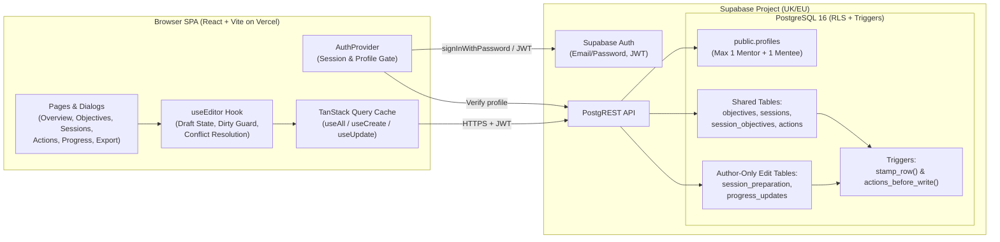

# Application Review

## Review scope and provenance

- **Review date:** 2026-10-23
- **Repository:** `nickbuildsthings/mentoring` (`https://github.com/nickbuildsthings/mentoring`)
- **Branch / commit reviewed:** `main` at commit `5396c6f` (`5396c6f24f514952d82cd5d570f0db0cfc3d1d0c`, merge of PR #1 `feat/mentoring-workspace-v1` / `15cee31`)
- **Areas inspected:**
  - Documentation and operational runbooks (`README.md`, `docs/SETUP.md`, `docs/BACKUP.md`)
  - Package manifests, lockfile, TypeScript, Vite, and Vercel deployment configuration (`package.json`, `package-lock.json`, `tsconfig.json`, `vite.config.ts`, `vercel.json`, `.env.example`, `.gitignore`, `index.html`)
  - Database schema, triggers, indexes, constraints, and row-level security policies (`supabase/migrations/20260101000000_core_schema.sql`, `supabase/provision.example.sql`)
  - Database and live API access-control test suites (`supabase/tests/00_local_shim.sql`, `supabase/tests/access.sql`, `supabase/tests/run-local.sh`, `scripts/test-access.mjs`)
  - Front-end application source code and unit tests (`src/main.tsx`, `src/App.tsx`, `src/styles.css`, `src/auth/*`, `src/lib/*`, `src/data/*`, `src/components/*`, `src/pages/*`)
- **Checks actually performed:**
  - Read-only static inspection of all repository source, SQL, test, configuration, and documentation files.
  - Cross-verification of documented requirements and operational procedures (`README.md`, `docs/SETUP.md`, `docs/BACKUP.md`) against the implemented SQL schema, RLS policies, React components, and data hooks.
- **Exclusions, limitations and unavailable evidence:**
  - In accordance with the review working rules, no packages were installed, no scripts or tests were executed, no services were started, and no external systems (live Supabase project, Vercel deployment, or npm advisory APIs) were queried.
  - Live hosting state, actual Supabase plan tier, real user traffic, runtime latency, and cloud billing data are unavailable from the repository alone.
  - If you would like automated verification run before implementation planning, two read-only local checks would materially add evidence once dependencies/binaries are available: `npm test && npm run typecheck` (unit tests and TypeScript verification) and `npm run test:db` (executing `supabase/tests/access.sql` against a throwaway local PostgreSQL instance).

---

## Executive summary

### What the application is
**Mentoring Workspace** is a private, single-pair web application designed for exactly one mentor and one mentee to structure and record their mentoring relationship around a coherent lifecycle: **objectives → sessions (and preparation) → actions → reflections/evidence/feedback/achievements → periodic progress reviews → full data export**. It is implemented as a client-side React single-page application (SPA) backed directly by Supabase (PostgreSQL, PostgREST, and Supabase Auth) and configured for static hosting on Vercel.

### Overall assessment
For a v1 release (`0.1.0`), the codebase is unusually well-disciplined, compact (~1,800 lines of TypeScript/CSS/SQL), and thoughtfully engineered. Its core security posture—default-deny PostgreSQL Row-Level Security (`FORCE ROW LEVEL SECURITY`), server-side attribution and version stamping via triggers, link protocol allowlisting, plain-text rendering, and a strict Content Security Policy—is strong and proportionate to a two-person workspace.

At the same time, evaluating the application from two complementary lenses—**technical/operational readiness** and **functional depth for the mentoring process (including multi-mentee expansion)**—reveals two distinct sets of high-value improvements:
1. **Technical & operational readiness (`REC-001` – `REC-012`):** Static analysis surfaced confirmed defects in password recovery/account security, editor concurrency handling, review-workspace auto-saving, backup restoration instructions, and dependency version pins that should be resolved before relying on the workspace for live mentoring sessions.
2. **Functional depth, multi-mentee support & mentoring experience (`REC-014` – `REC-021`):**
   - **Hardcoded single-pair cap (`REC-014`):** The database enforces `UNIQUE(role)` on `public.profiles` (`20260101000000_core_schema.sql:17`) and lacks a `partnership_id` tenancy boundary on content tables, making it impossible to mentor more than one person or onboard additional mentees without exposing one mentee's private records to another.
   - **Pre-session preparation is buried below post-session notes** on the session page and does not flow into a live session agenda, nor does completing a session prompt scheduling the next one (`REC-015`).
   - **When a mentee marks an action `blocked` and asks for support**, the mentor's Overview dashboard (which defaults to showing only `Mine`) hides the mentee's blocked action (`REC-016`).
   - **Reflections, evidence, and feedback are one-way monologues**—the mentoring partner cannot add a coaching response/acknowledgement or flag a reflection to discuss in the next session (`REC-017`).
   - **Guided coaching prompts disappear after creation** (and don't exist for evidence, feedback, or achievements), and completing an action cannot easily be promoted into development evidence (`REC-018`).
   - **There is no Mentoring Charter / Working Agreement** or guided first-run contracting experience to anchor each partnership (`REC-019`), **no intermediate progress/confidence trajectory or unified story timeline** on long-running objectives (`REC-020`), and **no curated "Development Portfolio" export** for mentees who want to share achievements and evidence without exposing raw session notes (`REC-021`).

### The most important findings and opportunities
1. **Multi-mentee & multi-partnership expansion with strict tenant isolation and in-app onboarding (`REC-014`):** Expanding from a single hardcoded pair (`UNIQUE(role)` on `profiles`) to support multiple mentees requires introducing a first-class `partnerships` table (`mentor_id`, `mentee_id`), scoping all content tables and RLS policies by `partnership_id` so Mentee A can never see Mentee B's data, adding a Mentee Switcher + Cross-Mentee Mentor Overview, and replacing manual SQL provisioning (`supabase/provision.example.sql`) with an in-app mentee onboarding/invitation flow.
2. **Broken password recovery flow & admin password exposure (`REC-001`):** `docs/SETUP.md` instructs the administrator to either set initial passwords or use Supabase's "send recovery" email flow, and `README.md` notes there is no in-app password reset. However, `src/lib/supabase.ts` disables URL session detection (`detectSessionInUrl: false`) and the app provides no `PASSWORD_RECOVERY` handler or in-app "Change password" UI. As a result, recovery emails cannot complete, and if the admin sets a password manually, the user has no way to change it to a secret known only to themselves.
3. **Rapid-fire concurrency failures and missing closing summaries in the Review Workspace (`REC-002`):** In `SessionDetail.tsx`, `ReviewObjective` triggers an optimistic-concurrency `UPDATE` on every `onChange` event of the `<input type="date">` control (firing on intermediate keystrokes) and allows marking objectives `achieved` or `closed` without exposing the `closing_summary` field.
4. **Non-atomic session saves and false self-conflict alerts (`REC-003`):** Updating a session in `SessionDetail.tsx` performs two sequential network mutations (`sessions` then `session_objectives`) while `useUpdate` invalidates the query cache before `useEditor` updates its baseline refs. This can flash false conflict banners against the user's own save and leaves session-objective links out of sync if the second call fails.
5. **Backup restore instructions fail on managed Supabase (`REC-004`):** `docs/BACKUP.md` instructs operators to run `pg_restore --data-only --disable-triggers --schema=public`. On managed Supabase PostgreSQL, `DISABLE TRIGGER ALL` fails with a superuser permission error on system foreign-key triggers, and restoring tables alphabetically without disabling foreign keys fails because `actions` and `objectives` are restored before `profiles`.
6. **Unresolvable / non-standard package versions in `package.json` and `package-lock.json` (`REC-005`):** The manifest and lockfile reference version numbers (e.g., `typescript@^7.0.2`, `vite@^8.3.4`, `vitest@^5.0.5`, `@types/node@^26.6.5`) that require verification against the public npm registry before CI/CD or clean Vercel builds can be trusted.
7. **Stage-aware session facilitation, partner responses on reflections, and blocked-action visibility (`REC-015` – `REC-021`):** Restructuring the session page around preparation → live agenda → wrap-up (including scheduling the next session), surfacing partner-blocked actions on the Overview page, enabling partner coaching responses on progress updates, and adding a Mentoring Charter, Objective Story Timeline, and Development Portfolio export will transform the app from a passive database into a rich mentoring companion.

### Urgent risks
- **Credential privacy & account recovery (`REC-001`):** High urgency before onboarding real participants, as mentoring notes contain sensitive personal reflections and performance discussions that should not be accessible to a deployment administrator who provisioned initial passwords.
- **Unverified backup restore path (`REC-004`):** High urgency before live use, because the documented restore command will fail during an actual data-recovery event.

---

## Application purpose and users

- **Plain-English purpose:** A shared digital notebook and tracker for a 1:1 mentoring relationship. It replaces scattered meeting docs, chat threads, and spreadsheets with a structured record linking long-term development objectives, session agendas/notes, agreed follow-up actions, and ongoing evidence or reflections.
- **Intended users:** Exactly two approved participants—one `mentor` and one `mentee`—enforced at the database level via `UNIQUE(role)` on `public.profiles` (`supabase/migrations/20260101000000_core_schema.sql:14-18`). A third persona, the deployment administrator (likely one of the two participants or a technical facilitator), provisions the Supabase and Vercel projects and manages user accounts via the Supabase dashboard (`docs/SETUP.md:3-8`, `39-41`).
- **Principal user journeys and implemented capabilities:**
  1. **Authentication & access gate:** Email/password sign-in (`src/pages/SignIn.tsx`), membership verification against `public.profiles` (`src/auth/AuthProvider.tsx:27-37`), and an explicit "No access" screen for authenticated users not listed in `profiles`.
  2. **Overview dashboard (`src/pages/Overview.tsx`):** Displays the next planned session and whether each participant has completed preparation, outstanding actions (filterable by Mine / Partner / Both) with overdue badges, active and proposed objectives with latest updates, and a 10-item recent activity feed.
  3. **Objective lifecycle (`src/pages/ObjectivesPage.tsx`, `src/pages/ObjectiveDetail.tsx`):** Propose, agree/activate, pause, achieve, close, or archive development objectives with observable success criteria, context, development area, target review date, and closing summary.
  4. **Session lifecycle & preparation (`src/pages/SessionsPage.tsx`, `src/pages/SessionDetail.tsx`):** Schedule sessions in `Europe/London` wall-clock time, link covered objectives, record independent per-participant preparation notes (`session_preparation`), capture shared discussion notes and agreed outcomes, review outstanding actions from earlier sessions, and run structured progress reviews (`is_review = true`).
  5. **Action tracking (`src/components/ActionDialog.tsx`, `src/pages/ActionsPage.tsx`):** Create, filter, edit, complete, block (with blocked/completion notes), and archive actions assigned to either role and optionally linked to an objective and originating session.
  6. **Progress updates (`src/components/UpdateDialog.tsx`, `src/components/UpdateList.tsx`, `src/pages/ProgressPage.tsx`):** Log reflections (with guided prompts on creation), concrete evidence, feedback, and achievements with optional `http(s)` links. Enforces author-only editing and archiving.
  7. **Portability / Export (`src/pages/ExportPage.tsx`, `src/lib/export.ts`):** Full client-side export of all 7 tables (including archived records) as human-readable Markdown or structured JSON.
- **Repository topology:** A single monolithic front-end SPA (`src/`) paired with declarative PostgreSQL schema/migrations (`supabase/`), access tests (`supabase/tests/`, `scripts/`), and operator documentation (`docs/`). There are no separate backend microservices or shared workspace packages.
- **Apparent maturity:** **Pre-production v1 release candidate** (`version: "0.1.0"` in `package.json:4`). The implementation is feature-complete against its internal specification codes (`AUTH`, `TECH-03/04/09/12` referenced in `README.md:11` and `docs/BACKUP.md:1`), but `README.md:24-25` explicitly notes that the UI was exercised against a mocked Supabase API rather than a live project and `docs/BACKUP.md:8-12` contains an uncompleted pre-launch checklist.
- **Documented purpose vs. implemented behaviour mismatches:**
  - `docs/SETUP.md:40` states that password resets are performed via `Supabase dashboard > Authentication > Users > the user > send recovery / set password`. In the code, `src/lib/supabase.ts:11` sets `detectSessionInUrl: false` and there is no password-update screen, making the "send recovery" option non-functional (`REC-001`).
  - `README.md:11` references `supabase/migrations/*core_schema.sql`; while the glob matches `supabase/migrations/20260101000000_core_schema.sql`, `README.md:12` states that `stamp_row` sets attribution metadata across records, whereas `session_objectives` (`supabase/migrations/20260101000000_core_schema.sql:115-121`) relies on a column default (`default auth.uid()`) rather than a `stamp_row` trigger (`REC-010`).
  - `docs/BACKUP.md:25` documents a `pg_restore --data-only --disable-triggers` command that fails against standard managed Supabase privileges and foreign-key ordering (`REC-004`).

---

## Technology inventory

| Technology | Role | Version where known | Evidence | Notes or uncertainty |
|---|---|---|---|---|
| **TypeScript** | Application language & typechecker | Declared `^7.0.2` | `package.json:27`, `tsconfig.json:1-18` | Actively used across `src/`. Note: `^7.0.2` is non-standard on public npm (where TypeScript is 5.x); see `REC-005`. |
| **React & React DOM** | UI component library | Declared `^19.3.1` | `package.json:18-19`, `src/main.tsx:1-2` | Demonstrably used (`StrictMode`, hooks, `useId`). Verify exact semver availability (`REC-005`). |
| **React Router DOM** | Client-side routing & navigation blocking | Declared `^7.18.4` | `package.json:20`, `src/App.tsx:1`, `src/components/useEditor.tsx:2` | Demonstrably used (`createBrowserRouter`, `useBlocker`, `NavLink`). |
| **TanStack React Query** | Async state, caching & mutations | Declared `^5.104.5` | `package.json:17`, `src/main.tsx:3`, `src/data/hooks.ts:1` | Demonstrably used for all data reads and writes. |
| **Supabase JS (`@supabase/supabase-js`)** | Browser & test client for PostgREST and Auth | Declared `^2.118.0` | `package.json:16`, `src/lib/supabase.ts:1`, `scripts/test-access.mjs:5` | Demonstrably used. No Realtime, Storage, or Edge Functions are used. |
| **Supabase (PostgreSQL + Auth + PostgREST)** | Database, authentication, and row-level security API | Postgres 16 (per `README.md:25`) | `supabase/migrations/20260101000000_core_schema.sql` | Core backend. Live Supabase project status and plan tier are unknown (`docs/BACKUP.md:8`). |
| **Vite & `@vitejs/plugin-react`** | Front-end build tool and dev server | Declared `^8.3.4` / `^6.1.2` | `package.json:26,28`, `vite.config.ts:1-9` | Used for `dev`, `build`, `preview`. Verify version pins (`REC-005`). |
| **Vitest** | Unit test runner | Declared `^5.0.5` | `package.json:29`, `vite.config.ts:8`, `src/lib/*.test.ts` | Used in `node` environment for 3 unit test files. Verify version pin (`REC-005`). |
| **Vercel** | Static SPA hosting & HTTP response headers | Configuration only | `vercel.json:1-24`, `docs/SETUP.md:12-17` | Configures SPA rewrite, CSP, HSTS, and caching headers. Live deployment status is unknown. |
| **Bash + PostgreSQL CLI (`initdb`, `pg_ctl`, `psql`, `pg_dump`, `pg_restore`)** | Local DB test runner and manual backup tooling | System binaries | `supabase/tests/run-local.sh:1-24`, `docs/BACKUP.md:16-26` | Used for local RLS testing and manual logical backups. |
| **Plain CSS (`src/styles.css`)** | Styling and responsive layout | Custom CSS variables | `src/styles.css:1-122` | Zero CSS framework dependencies; clean, low-overhead stylesheet. |

---

## Architecture and principal user journeys

### Architectural summary
The system uses a **two-tier client-to-BaaS architecture**:
1. **Browser SPA (`src/`):** Served as static assets from Vercel (`dist/`). All routing is client-side (`createBrowserRouter`). There is no custom middle-tier server.
2. **Supabase Backend (`supabase/`):**
   - **Supabase Auth (`auth.users`):** Handles email/password authentication and issues short-lived JWTs (`authenticated` role).
   - **PostgREST (`public.*`):** Exposes the 7 PostgreSQL tables over HTTPS REST endpoints.
   - **Database-enforced domain & security logic:** RLS policies call `public.is_member()` (`SECURITY DEFINER`) to verify that `auth.uid()` exists in `public.profiles`. Triggers (`public.stamp_row` and `public.actions_before_write`) enforce server-side timestamps, user attribution (`created_by`, `updated_by`, `archived_by`), and optimistic concurrency (`version`).



### Major data flows
1. **Authentication & authorisation flow:**
   - User submits email and password in `SignIn.tsx` → `supabase.auth.signInWithPassword`.
   - `AuthProvider.tsx` listens to `onAuthStateChange` (deferring via `setTimeout(..., 0)` to avoid Supabase client deadlocks) and queries `public.profiles` for `id = session.user.id`.
   - If a profile row is returned, `state` transitions to `ready`; otherwise, `state` becomes `unauthorised` (`<NoAccess />`).
   - Any query returning HTTP `401`, `PGRST301`, or `JWT expired` triggers `QueryCache.onError` in `src/main.tsx:8-17`, automatically signing the user out and clearing the React Query cache.
2. **Read flow (`fetchAll`):**
   - Each page invokes hooks in `src/data/hooks.ts` (`useObjectives`, `useSessions`, etc.), which call `fetchAll` (`src/data/api.ts:14-28`) to paginate through the entire table in 1,000-row ranges. Filtering, searching, sorting, and relational joins are performed in-memory in the browser.
3. **Write & optimistic concurrency flow (`useEditor` + `updateRow`):**
   - Forms initialize a local draft via `useEditor` (`src/components/useEditor.tsx`).
   - On save, `updateRow` (`src/data/api.ts:40-53`) sends `UPDATE <table> SET ... WHERE id = :id AND version = :version`.
   - In Postgres, `stamp_row()` increments `version = old.version + 1` and stamps `updated_by = auth.uid()`.
   - If 0 rows match the `version` predicate, `updateRow` fetches the current row and throws `ConflictError(latest)`, prompting the user in `ConflictBanner` to either load the partner's version or overwrite it.

---

## What is already working well

1. **Defence-in-depth database security (`supabase/migrations/20260101000000_core_schema.sql`):**
   - Every table has both `ENABLE ROW LEVEL SECURITY` and `FORCE ROW LEVEL SECURITY` (`lines 216-230`).
   - Default privileges are revoked from `anon` and `authenticated`, and `DELETE` is not granted on any content table (`lines 232-236`), preventing accidental or malicious hard deletion via the client API.
   - `public.is_member()` and `public.my_role()` use `SECURITY DEFINER SET search_path = ''` and `(select auth.uid())` (`lines 21-32`), preventing `search_path` hijacking and allowing PostgreSQL to cache `auth.uid()` per statement.
2. **Server-side attribution and tamper-proof audit metadata (`20260101000000_core_schema.sql:46-73`):**
   - `stamp_row()` overwrites `id`, `created_at`, `created_by`, `updated_at`, `updated_by`, `version`, and `archived_by` inside a `BEFORE INSERT OR UPDATE` trigger, ensuring neither participant can spoof authorship or backdate records via crafted API calls.
3. **Executable database and API security tests (`supabase/tests/access.sql`, `scripts/test-access.mjs`):**
   - `access.sql` thoroughly tests anonymous users, authenticated outsiders, mentor/mentee shared writes, author-only writes (`progress_updates`, `session_preparation`), link validation constraints, version conflict detection, and the 2-member cap (`UNIQUE(role)`).
4. **Hardened browser security posture (`vercel.json`, `src/lib/links.ts`, `src/auth/AuthProvider.tsx`):**
   - Strict CSP (`default-src 'self'`, `frame-ancestors 'none'`, `object-src 'none'`), `Cache-Control: no-store` on HTML routes, no `dangerouslySetInnerHTML`, strict URL protocol parsing (`http:`/`https:` only) in both JS and SQL, and generic sign-in error messages that prevent email enumeration.
5. **Thoughtful domain modelling and UX details:**
   - Explicit `Europe/London` timezone handling across BST/GMT transitions (`src/lib/format.ts` and `src/lib/format.test.ts`).
   - Status badges always pair symbols with text labels (`src/components/ui.tsx:55-65`) rather than relying on colour alone.
   - Clear transparency notices (`SharedNotice` in `src/components/ui.tsx:173-179`) reminding both participants that all notes in the workspace are shared.

---

## Findings and recommendations

### Comparison table

| ID | Recommendation | Category | Urgency | Expected benefit | Effort | Confidence |
|---|---|---|---|---|---|---|
| **REC-001** | Support in-app password change and fix or remove the broken password recovery flow | Security, Privacy & Onboarding | **High** | Ensures admin cannot retain user passwords; makes password recovery actually work as documented | Small | High |
| **REC-002** | Fix Review Workspace date auto-save race condition and missing closing summary | Product & Reliability | **High** | Prevents immediate conflict errors when typing review dates and preserves closing summaries | Small | High |
| **REC-003** | Make session + objective-link saving atomic and eliminate `useEditor` self-conflict race | Reliability & UX | **High** | Eliminates false "someone else changed this" banners and partial session saves | Small | High |
| **REC-004** | Fix `docs/BACKUP.md` restore procedure for managed Supabase permissions and FK order | Operations & Reliability | **High** | Ensures backups can actually be restored on Supabase without superuser/FK errors | Small | High |
| **REC-005** | Reconcile non-standard package versions in `package.json` / `package-lock.json` and add CI checks | Maintainability & Supply Chain | **High** | Guarantees reproducible builds and automated regression/RLS testing on every commit | Small | High |
| **REC-006** | Distinguish network/server errors from "unauthorised" in `AuthProvider` | Reliability & UX | **Medium** | Prevents transient connection drops from showing a misleading "No access" screen | Small | High |
| **REC-007** | Validate reflection combined length and 10-link cap client-side, and preserve draft text on type switch | Product & Usability | **Medium** | Prevents opaque DB constraint errors and accidental loss of reflection answers | Small | High |
| **REC-008** | Include unlinked/objective actions in Session view and expand search to session notes and progress content | Product & User Value | **Medium** | Surfaces all open actions during sessions and makes historical notes/updates searchable | Small | High |
| **REC-009** | Show complete field diffs in `ConflictBanner` and sync archive toggles with `useEditor` | Usability & Data Integrity | **Medium** | Prevents silent overwrites of unshown fields and self-conflicts when archiving | Small | High |
| **REC-010** | Harden schema edge cases (`valid_links` NULL handling, `session_objectives` attribution, `profiles` FK cascade, London `current_date`) | Security & Data Integrity | **Medium** | Closes schema consistency gaps and prevents admin user-replacement deadlocks | Small | High |
| **REC-011** | Use native `<dialog>` for the unsaved-changes route blocker to ensure keyboard focus trapping and Escape handling | Accessibility & Usability | **Low** | Aligns route-leave modal with `Modal` accessibility standards | Small | High |
| **REC-012** | Optimise data fetching, cache reuse on export, and index alignment | Performance & Operating Cost | **Low** | Reduces redundant PostgREST queries and network egress on tab focus and exports | Small | High |
| **REC-013** | Evaluate optional MFA (TOTP) and `.ics` calendar export for planned sessions | Exploratory / Product & Security | **Low** | Stronger authentication for sensitive notes and easier calendar scheduling if users want it | Medium | Medium |
| **REC-014** | Multi-mentee & multi-partnership tenancy model, per-partnership RLS isolation, and in-app mentee onboarding | Architecture, Security & Multi-Mentee | **High** | Enables mentoring multiple mentees (with strict data isolation between pairs), in-app onboarding, and a Mentee Switcher / Mentor Overview | Large | High |
| **REC-015** | Restructure `SessionDetail` into a stage-aware Facilitation & Agenda workspace with post-session wrap-up | Mentoring Experience & Sessions | **High** | Connects pre-session prep directly to live note-taking and ensures the next session is scheduled before wrapping up | Medium | High |
| **REC-016** | Surface partner-blocked actions and support requests prominently on `Overview` and `SessionDetail` | Mentoring Experience & Momentum | **High** | Prevents a mentee's blocked action / help request from being hidden behind the mentor's default `Mine` filter | Small | High |
| **REC-017** | Enable two-way mentoring dialogue on Progress Updates (partner coaching response & "Discuss next session" flag) | Mentoring Experience & Reflection | **High** | Turns isolated reflections/evidence into an interactive coaching conversation between sessions | Medium | High |
| **REC-018** | Provide structured prompts across all `ProgressUpdate` types and one-click promotion of completed Actions to Evidence | Mentoring Experience & Evidence | **Medium** | Scaffolds better evidence/feedback entries, preserves reflection structure on edit, and links action completion to evidence | Small | High |
| **REC-019** | Add a shared Mentoring Charter / Working Agreement and guided first-run onboarding per partnership | Mentoring Experience & Contracting | **Medium** | Anchors each partnership in agreed ground rules, expectations, and horizon instead of starting on four empty states | Medium | High |
| **REC-020** | Deepen Objectives with observable milestones, confidence/progress trajectory, stalled alerts, and a unified Story Timeline | Mentoring Experience & Objectives | **Medium** | Makes multi-month progress visible and tells the chronological story of how an objective developed | Medium | High |
| **REC-021** | Enrich the Progress Review Workspace with period synthesis and add a shareable "Development Portfolio" export mode | Mentoring Experience & Reviews | **Medium** | Surfaces period-over-period accomplishments during reviews and lets mentees export a clean portfolio without raw session notes | Small | High |

---

### Part 1: Confirmed issues worth addressing

#### REC-001: Support in-app password change and fix or remove the broken password recovery flow
- **Category:** Security, Privacy & Onboarding
- **Finding or opportunity:**
  `docs/SETUP.md` instructs the administrator to create the two user accounts with initial passwords (`line 6`) and states that password resets are handled via `Supabase dashboard > Authentication > Users > the user > send recovery / set password` (`line 40`). However:
  1. `src/lib/supabase.ts:11` sets `detectSessionInUrl: false` and `src/auth/AuthProvider.tsx:39-42` has no handler for Supabase's `PASSWORD_RECOVERY` auth event, nor is there any UI route/dialog calling `supabase.auth.updateUser({ password })`. Consequently, clicking **"send recovery"** in the Supabase dashboard sends a link that the application ignores.
  2. If the administrator instead uses **"set password"** in the Supabase dashboard (both at initial setup and during account recovery), the administrator knows the participant's password, and the participant has **no way in the application to change their own password**. If the administrator is also one of the participants (e.g., the mentor setting up the app), they effectively know the other participant's credentials; even if the administrator is a third party, participants cannot establish a private password.
- **Repository evidence:**
  - `docs/SETUP.md:6, 40`
  - `README.md:19`
  - `src/lib/supabase.ts:10-12` (`detectSessionInUrl: false`)
  - `src/auth/AuthProvider.tsx:39-64` (only `signInWithPassword` and `signOut` are implemented)
- **Who benefits and how:**
  Both mentor and mentee gain credential privacy and a working self-service password update mechanism after initial provisioning or recovery; the administrator has a recovery workflow that works as documented.
- **Proposed direction:**
  Provide a lightweight "Change password" control in the authenticated UI (calling `supabase.auth.updateUser({ password })`) so users can immediately replace an admin-provisioned temporary password, and either enable URL session detection with a `PASSWORD_RECOVERY` prompt or update `docs/SETUP.md` to match the intended admin-assisted flow.
- **Expected impact and the basis for that judgement:**
  **High.** Directly resolves a broken documented operational workflow (`docs/SETUP.md:40`) and eliminates credential sharing during onboarding.
- **Urgency:** High
- **Effort:** Small — requires a small modal/form calling `supabase.auth.updateUser` and a minor update to `AuthProvider.tsx` and `docs/SETUP.md`.
- **Confidence:** High
- **Risks, trade-offs and dependencies:**
  If `detectSessionInUrl: true` is enabled for recovery links, ensure the Supabase project's Redirect URLs and Site URL (`docs/SETUP.md:10`) are strictly locked to the production Vercel origin.
- **How success could be validated or measured:**
  Verify that a newly provisioned user can sign in with a temporary password and change it in-app, and verify that the documented recovery procedure in `docs/SETUP.md` succeeds end-to-end against a test Supabase project.
- **Open questions or additional evidence needed:**
  See Question 1 in *Questions and decisions needed* regarding whether the operator prefers email recovery links (`detectSessionInUrl: true`) or temporary password assignment followed by in-app password change.
- **Review status:** Accepted
- **Reviewer comments:**

---

#### REC-002: Fix Review Workspace date auto-save race condition and missing closing summary
- **Category:** Product & Reliability
- **Finding or opportunity:**
  Inside a progress review session (`is_review = true`), `ReviewObjective` (`src/pages/SessionDetail.tsx:296-318`) immediately calls `save({ review_date: v || null })` on every `onChange` event of `<TextInput type="date">`. In desktop browsers where users type a date via keyboard (e.g., typing `2026-12-01` fires `onChange` on intermediate year digits) or step through dates with arrow keys, multiple overlapping `UPDATE` requests are sent using the same stale `objective.version` prop. The second request fails the optimistic concurrency check (`version = :version`) and displays `"Couldn’t save — this objective may have been changed by someone else. Reload to see the latest."` Additionally, changing an objective's status to `achieved` or `closed` inside `ReviewObjective` (`line 311`) saves immediately without offering the `closing_summary` ("Review summary") textarea that `ObjectiveDetail.tsx:108-111` reveals for those statuses.
- **Repository evidence:**
  - `src/pages/SessionDetail.tsx:296-318` (`ReviewObjective` `onChange` handlers)
  - `src/pages/ObjectiveDetail.tsx:61, 108-111` (`closing_summary` shown when `status === 'achieved' || status === 'closed'`)
- **Who benefits and how:**
  Both participants during progress review sessions—preventing false conflict errors while updating review dates and ensuring objectives closed during a review capture their closing summary.
- **Proposed direction:**
  Avoid firing optimistic-locked mutations on every raw `<input type="date">` `onChange` keystroke (e.g., save on blur/explicit button or via `useEditor` per objective card), and expose the `closing_summary` field when an objective is marked `achieved` or `closed` in the review workspace.
- **Expected impact and the basis for that judgement:**
  **High.** Progress reviews are a core workflow (`is_review`), and keyboard date entry currently triggers deterministic concurrency errors.
- **Urgency:** High
- **Effort:** Small — localized to `ReviewObjective` in `src/pages/SessionDetail.tsx`.
- **Confidence:** High
- **Risks, trade-offs and dependencies:**
  Switching `ReviewObjective` from instant-save-on-change to an explicit save button or blur/debounced save slightly changes the interaction model noted in the helper copy (`src/pages/SessionDetail.tsx:283`).
- **How success could be validated or measured:**
  Type a full date via keyboard into a `ReviewObjective` date input and transition an objective to `achieved` in the review workspace without triggering conflict errors.
- **Open questions or additional evidence needed:** None.
- **Review status:** Accepted
- **Reviewer comments:**

---

#### REC-003: Make session + objective-link saving atomic and eliminate `useEditor` self-conflict race
- **Category:** Reliability & UX
- **Finding or opportunity:**
  Two related concurrency issues exist in the editor/mutation layer:
  1. In `src/data/hooks.ts:26-33`, `useUpdate` returns `qc.invalidateQueries({ queryKey: [table] })` from `onSuccess`. In TanStack Query v5, `mutateAsync` awaits `onSuccess` promises before resolving. Consequently, the refetched `record` (with `version + 1`) is delivered to `useEditor`'s `useEffect([record])` (`src/components/useEditor.tsx:58-65`) **before** `await save(sent, base)` returns at `line 81` and before `baseRef.current = saved` (`line 82`) and `baselineRef.current` (`line 84`) are updated. At that instant, `record.version !== base.version` and `isDirty()` is still `true`, causing `useEditor` to call `setConflict(record)` against the user's own save.
  2. In `src/pages/SessionDetail.tsx:80-84`, `save` awaits `update.mutateAsync(...)` on `sessions` and then sequentially awaits `setLinks.mutateAsync(...)` on `session_objectives`. During the entire `setLinks` network round-trip (or permanently if `setLinks` fails), the `sessions` query has already refetched at `version + 1` while `baseRef.current` is still at the old version, flashing or latching a false `ConflictBanner` showing the user's own name as the conflicting editor. Furthermore, if the user only changed the linked objective checkboxes on a session, `sessions` still receives an empty `UPDATE` that bumps `sessions.version` and `updated_at`.
- **Repository evidence:**
  - `src/components/useEditor.tsx:58-99`
  - `src/data/hooks.ts:18-42`
  - `src/pages/SessionDetail.tsx:67-86`
  - `src/data/api.ts:40-66`
- **Who benefits and how:**
  Both mentor and mentee experience reliable, flicker-free saves on sessions and all other records without alarming false-positive conflict alerts.
- **Proposed direction:**
  Update `useEditor` to track an in-flight save flag (or update `baseRef`/`baselineRef` before cache invalidation settles) so incoming refetches from the editor's own save never trigger `setConflict`, and handle session + objective link updates safely (either via a single transactional RPC or by updating `baseRef.current` immediately after `sessions` saves so a `setLinks` failure can be retried cleanly without a false version conflict).
- **Expected impact and the basis for that judgement:**
  **High.** Directly prevents false data-conflict warnings and broken recovery states when saving sessions.
- **Urgency:** High
- **Effort:** Small — confined to `src/components/useEditor.tsx`, `src/data/hooks.ts`, and `src/pages/SessionDetail.tsx`.
- **Confidence:** High
- **Risks, trade-offs and dependencies:**
  If a database RPC is used for atomic session + link updates, it requires a small SQL migration; handling it in `useEditor`/`SessionDetail` requires no schema change but leaves the two-step write non-transactional across network drops.
- **How success could be validated or measured:**
  Add a unit/integration test for `useEditor` with asynchronous query invalidation and multi-step `save` callbacks, verifying `conflict` remains `null` throughout the save lifecycle.
- **Open questions or additional evidence needed:** None.
- **Review status:** Accepted
- **Reviewer comments:**

---

#### REC-004: Fix `docs/BACKUP.md` restore procedure for managed Supabase permissions and FK order
- **Category:** Operations & Reliability
- **Finding or opportunity:**
  `docs/BACKUP.md:25-26` instructs operators to restore backups into a scratch or recovery Supabase project using:
  `pg_restore --data-only --disable-triggers --schema=public -d <scratch> mentoring.dump`
  On managed Supabase PostgreSQL instances, this command fails for two reasons:
  1. `--disable-triggers` emits `ALTER TABLE ... DISABLE TRIGGER ALL`, which attempts to disable PostgreSQL internal foreign-key constraint triggers (`RI_ConstraintTrigger_*`). Because the `postgres` role on hosted Supabase is not a true PostgreSQL `SUPERUSER`, PostgreSQL rejects this with `ERROR: permission denied: "RI_ConstraintTrigger_..." is a system trigger`.
  2. Without disabling foreign-key triggers, `pg_restore --data-only` restores tables in archive/alphabetical order (`actions` and `objectives` before `profiles` and `sessions`), which immediately fails foreign-key constraint checks, AND the `stamp_row()` user triggers overwrite `created_at`, `created_by`, `updated_at`, and `version`.
- **Repository evidence:**
  - `docs/BACKUP.md:18-28`
  - `supabase/migrations/20260101000000_core_schema.sql:46-73, 193-203`
- **Who benefits and how:**
  The workspace administrator and both participants—ensuring that a backup taken under `docs/BACKUP.md` can actually be restored without losing original timestamps, authorship, or foreign-key integrity.
- **Proposed direction:**
  Update `docs/BACKUP.md` (and optionally provide a small SQL/restore helper script) that disables **user** triggers (`ALTER TABLE public.<t> DISABLE TRIGGER USER;` which does not require `SUPERUSER`), restores tables in topological parent-first order (`profiles` → `objectives` → `sessions` → `session_objectives` → `session_preparation` → `actions` → `progress_updates`) or uses `session_replication_role` / ordered `-t` flags, and re-enables user triggers afterward.
- **Expected impact and the basis for that judgement:**
  **High.** An untested backup restore command that fails on managed Supabase permissions undermines the disaster-recovery guarantee (`TECH-09`).
- **Urgency:** High
- **Effort:** Small — documentation update in `docs/BACKUP.md` and optional restore script.
- **Confidence:** High
- **Risks, trade-offs and dependencies:**
  Must be verified once against a real scratch Supabase project as already required by `docs/BACKUP.md:22-28`.
- **How success could be validated or measured:**
  Execute the updated `pg_dump` and `pg_restore` sequence against a scratch Supabase project and confirm row counts, original `created_at`/`created_by`/`version` values, and `npm run test:access` all pass.
- **Open questions or additional evidence needed:** None.
- **Review status:** Accepted
- **Reviewer comments:**

---

#### REC-005: Reconcile non-standard package versions in `package.json` / `package-lock.json` and add CI checks
- **Category:** Maintainability & Supply Chain
- **Finding or opportunity:**
  1. `package.json` and `package-lock.json` specify several package versions (`typescript@^7.0.2`, `vite@^8.3.4`, `vitest@^5.0.5`, `@vitejs/plugin-react@^6.1.2`, `@types/node@^26.6.5`, `@supabase/supabase-js@^2.118.0`, `@tanstack/react-query@^5.104.5`, `react@^19.3.1`, `react-router-dom@^7.18.4`) that appear synthetically generated or do not correspond to standard published releases on the public npm registry. If Vercel or a developer runs `npm ci` or `npm install` against registry.npmjs.org, installation will fail if any pinned tarball URL in `package-lock.json` does not exist.
  2. The repository has no `.github/workflows/` CI configuration to automatically run `npm run typecheck`, `npm test`, `npm run build`, and `npm run test:db` on pushes or pull requests.
- **Repository evidence:**
  - `package.json:15-30`
  - `package-lock.json:10-100`
  - Absence of `.github/workflows/`
- **Who benefits and how:**
  Developers and the deployment operator—ensuring Vercel deployments and local setups succeed deterministically and regressions in RLS policies or TypeScript types are caught automatically.
- **Proposed direction:**
  Verify `npm install` and `npm run build` against the live npm registry, pin all dependencies in `package.json` and `package-lock.json` to verified published versions, run `npm audit` to check for any known advisories, and add a single lightweight GitHub Actions workflow running typecheck, unit tests, build, and `npm run test:db` (using the Ubuntu runner's pre-installed PostgreSQL binaries).
- **Expected impact and the basis for that judgement:**
  **High.** Prevents immediate build failures on Vercel and ensures the strong PostgreSQL RLS test suite (`supabase/tests/access.sql`) runs on every change.
- **Urgency:** High
- **Effort:** Small — dependency pin adjustment and a single `.github/workflows/ci.yml` file.
- **Confidence:** High
- **Risks, trade-offs and dependencies:**
  GitHub Actions on public repositories is free (`nickbuildsthings/mentoring` is currently public), so adding CI incurs zero cloud cost.
- **How success could be validated or measured:**
  Clean `npm ci && npm run build && npm test && npm run test:db` passes locally and in GitHub Actions.
- **Open questions or additional evidence needed:** None.
- **Review status:** Accepted
- **Reviewer comments:**

---

### Part 2: Evidence-backed improvement opportunities

#### REC-006: Distinguish network/server errors from "unauthorised" in `AuthProvider`
- **Category:** Reliability & UX
- **Finding or opportunity:**
  When resolving a signed-in user's profile in `src/auth/AuthProvider.tsx:33-36`, the code executes:
  ```ts
  const { data, error } = await supabase.from('profiles').select('id, display_name, role').eq('id', session.user.id).maybeSingle();
  if (cancelled) return;
  if (error || !data) setState({ status: 'unauthorised' });
  ```
  If an approved mentor or mentee opens or refreshes the app while offline or during a transient network/Supabase error, `error` is truthy and `AuthProvider` sets `status: 'unauthorised'`. This renders `<NoAccess />` (`src/pages/SignIn.tsx:38-48`), which tells the user *"This account is not approved for this workspace, so no mentoring content is shown"* and offers only a **Sign out** button (no retry).
- **Repository evidence:**
  - `src/auth/AuthProvider.tsx:33-36`
  - `src/pages/SignIn.tsx:38-48`
  - `src/App.tsx:21`
- **Who benefits and how:**
  Both participants—avoiding a confusing false "account not approved" lockout and forced sign-out when opening the app on a flaky connection.
- **Proposed direction:**
  Separate a genuine missing profile (`!error && !data` → `unauthorised`) from a query/network failure (`error` → an error state with a "Try again" button that re-runs `resolve(session)`, while still signing out if `isAuthFailure(error)` is true).
- **Expected impact and the basis for that judgement:**
  **Medium.** Improves resilience on mobile/Wi-Fi transitions and prevents misleading security messaging.
- **Urgency:** Medium
- **Effort:** Small — minor state addition in `AuthProvider.tsx` and `App.tsx`.
- **Confidence:** High
- **Risks, trade-offs and dependencies:**
  Note that for an unapproved user, `profiles_read` RLS (`using (public.is_member())`) returns 0 rows (`data === null, error === null`) via `.maybeSingle()`, so `!error && !data` accurately identifies unapproved users without leaking anything.
- **How success could be validated or measured:**
  Simulate a failed network request on the initial `profiles` fetch and confirm a retryable connection error is shown rather than `<NoAccess />`.
- **Open questions or additional evidence needed:** None.
- **Review status:** Accepted
- **Reviewer comments:**

---

#### REC-007: Validate reflection combined length and 10-link cap client-side, and preserve draft text on type switch
- **Category:** Product & Usability
- **Finding or opportunity:**
  In `src/components/UpdateDialog.tsx`:
  1. **Silent loss of guided reflection text on type change (`lines 45-49, 59`):** When creating a new update, the default type is `reflection`, which shows three guided prompt textareas (`went_well`, `difficult`, `try_next`). If the user types into those fields and then switches the `Type` dropdown to `evidence`, `feedback`, or `achievement`, the guided fields disappear (`guided` becomes `false`) and saving discards their contents without warning.
  2. **Missing client-side check for the 10-link database limit (`line 81`, `src/lib/links.ts:14-23`):** The database constraint `public.valid_links(links)` (`supabase/migrations/20260101000000_core_schema.sql:38`) rejects arrays with more than 10 links (`coalesce(array_length(links, 1), 0) <= 10`), but `parseLinks()` does not check link count and the UI hint (`"One web link per line."`) does not mention the 10-link maximum. Submitting 11 valid URLs fails with a generic database check error (`23514`).
  3. **Guided reflection length overflow (`lines 73-76`):** The four textareas on a guided reflection allow `5000 + 5000 + 5000 + 10000 = 25,000` characters plus headings, exceeding the database `check (char_length(btrim(content)) between 1 and 20000)` constraint (`20260101000000_core_schema.sql:181`).
- **Repository evidence:**
  - `src/components/UpdateDialog.tsx:39-60, 70-82`
  - `src/lib/links.ts:14-23`
  - `supabase/migrations/20260101000000_core_schema.sql:34-40, 181-182`
- **Who benefits and how:**
  Participants recording reflections and evidence—preventing lost reflection notes when changing update categories and providing clear, specific validation messages before submitting.
- **Proposed direction:**
  When switching `type` away from `reflection` on a new update, either fold non-empty guided prompt answers into `content` or keep them; enforce the `<= 10` links limit and `<= 20,000` combined character limit in `UpdateDialog` with clear inline hints/messages.
- **Expected impact and the basis for that judgement:**
  **Medium.** Directly prevents user frustration and data loss in one of the primary content-creation dialogs.
- **Urgency:** Medium
- **Effort:** Small — confined to `src/components/UpdateDialog.tsx` and `src/lib/links.ts`.
- **Confidence:** High
- **Risks, trade-offs and dependencies:** None.
- **How success could be validated or measured:**
  Unit test `parseLinks` / `UpdateDialog` validation for >10 links, >20,000 combined chars, and switching update type after entering guided reflection text.
- **Open questions or additional evidence needed:** None.
- **Review status:** Accepted
- **Reviewer comments:**

---

#### REC-008: Include unlinked/objective actions in Session view and expand search to session notes and progress content
- **Category:** Product & User Value
- **Finding or opportunity:**
  Three small product gaps affect day-to-day mentoring usability:
  1. **Omitted open actions on Session detail (`src/pages/SessionDetail.tsx:95-100`):** The section *"Outstanding actions from earlier sessions"* filters for `origin && origin.id !== record.id && origin.scheduled_at < record.scheduled_at`. Any open action created from the Overview page, the Actions page, or an Objective detail page without an originating `session_id` (`a.session_id === null`) is completely excluded from this list during a normal session.
  2. **Session search only checks optional `title` (`src/pages/SessionsPage.tsx:23`):** `title` is optional on sessions and often left blank (sessions are identified primarily by `scheduled_at`). Searching on `SessionsPage` ignores `discussion_notes`, `outcomes`, and `location`, so searching for a topic discussed in a past session returns no results unless the keyword was in the optional title.
  3. **No text search on `ProgressPage` (`src/pages/ProgressPage.tsx:37-51`) and missing session updates in Markdown export (`src/lib/export.ts:59-71`):** `ProgressPage` wraps its filters in `<div className="filters" role="search">` but provides no text search input to find past reflections, evidence, or feedback by keyword. In addition, `buildMarkdown` (`src/lib/export.ts:59-71`) lists linked objectives, preparation, and actions under each session, but omits `progress_updates` linked to that session (`u.session_id === s.id`), and `ExportPage.tsx:43` omits `session_preparation` from the exported record count summary.
- **Repository evidence:**
  - `src/pages/SessionDetail.tsx:95-100`
  - `src/pages/SessionsPage.tsx:19-24, 29`
  - `src/pages/ProgressPage.tsx:37-51`
  - `src/lib/export.ts:59-71`
  - `src/pages/ExportPage.tsx:43-44`
- **Who benefits and how:**
  Both mentor and mentee—ensuring no open actions are overlooked during sessions, historical notes and reflections can be found by keyword as the workspace grows, and Markdown exports accurately reflect session-linked updates.
- **Proposed direction:**
  - In `SessionDetail.tsx`, include open actions where `session_id === null` (created before the session) alongside open actions from earlier sessions (or label the section *"Outstanding actions to check"*).
  - Expand `SessionsPage` search to match `title`, `discussion_notes`, `outcomes`, and `location` (and update the input label from "Search titles" to "Search sessions"), and add a keyword search input to `ProgressPage` (and optionally `ActionsPage` description/notes).
  - Include session-linked `progress_updates` in `buildMarkdown`'s session section and include `session_preparation.length` in `ExportPage`'s status count.
- **Expected impact and the basis for that judgement:**
  **Medium.** High user-value-to-effort ratio; directly strengthens the core `objective → session → action → evidence → review` loop without adding new concepts or tables.
- **Urgency:** Medium
- **Effort:** Small — client-side filter and export formatting adjustments.
- **Confidence:** High
- **Risks, trade-offs and dependencies:** None; all data is already loaded in memory on these pages.
- **How success could be validated or measured:**
  Verify that an open action created without a `session_id` appears in the next session's outstanding actions list, that searching a word from `discussion_notes` or `progress_updates.content` finds the record, and that `export.test.ts` verifies session updates in Markdown output.
- **Open questions or additional evidence needed:** None.
- **Review status:** Accepted
- **Reviewer comments:**

---

#### REC-009: Show complete field diffs in `ConflictBanner` and sync archive toggles with `useEditor`
- **Category:** Usability & Data Integrity
- **Finding or opportunity:**
  1. **Incomplete conflict comparison (`src/components/ui.tsx:130-148`):** `ConflictBanner` only renders the subset of `fields` explicitly passed by the parent component and filters out any field whose new value is empty (`fields.filter((f) => f.read(c).trim() !== '')` at `line 139`). As a result:
     - If the partner *cleared* a field (e.g., removed a `review_date` or `context`), it is hidden from the conflict view.
     - Several editable fields are never passed to `ConflictBanner` at all (e.g., `ObjectiveDetail.tsx:88-92` omits `development_area` and `review_date`; `SessionDetail.tsx:113-116` omits `scheduled_at`, `location`, `meeting_link`, `is_review`, `review_changed`, `review_difficult`, `review_focus`, and `objective_ids`; `ActionDialog.tsx:54-57` omits `owner_role`, `objective_id`, `session_id`, `blocked_note`, `completion_note`). Clicking "Save mine over theirs" can therefore silently overwrite changes the user was never shown.
  2. **Archive button conflicts with open editor (`src/pages/ObjectiveDetail.tsx:121-124`, `src/pages/SessionDetail.tsx:165-168`):** Clicking "Archive objective" or "Archive session" mutates the record outside `useEditor`, incrementing `version` in the database. If the user had any unsaved edits in the form above, `useEditor` detects the version bump and displays a conflict banner against the user themselves. In addition, the *"Agree and activate"* button on proposed objectives (`ObjectiveDetail.tsx:82`) only patches local draft state (`editor.patch({ status: 'active' })`) and requires scrolling to the bottom of the form to click Save.
- **Repository evidence:**
  - `src/components/ui.tsx:130-148`
  - `src/pages/ObjectiveDetail.tsx:79-92, 121-124`
  - `src/pages/SessionDetail.tsx:113-116, 165-168`
  - `src/components/ActionDialog.tsx:54-57`
  - `src/components/UpdateDialog.tsx:66`
- **Who benefits and how:**
  Both participants—seeing exactly which fields actually differ when a concurrent edit occurs, and avoiding self-conflicts when archiving or activating an objective.
- **Proposed direction:**
  Pass all editable fields to `ConflictBanner` and filter to only the fields where the partner's value (`read(c)`) differs from the user's draft (including when a field was cleared to `(empty)`). Make "Agree and activate" persist immediately (when the form is not otherwise dirty), and have the Archive/Restore button either warn if `editor.dirty` is true or update `editor`'s base record cleanly.
- **Expected impact and the basis for that judgement:**
  **Medium.** Makes conflict resolution trustworthy and removes awkward interactions on detail pages.
- **Urgency:** Medium
- **Effort:** Small — updates to `ConflictBanner` and detail page action handlers.
- **Confidence:** High
- **Risks, trade-offs and dependencies:** None.
- **How success could be validated or measured:**
  Trigger a concurrent update that modifies `review_date` or clears `context` and verify `ConflictBanner` displays only the changed/cleared fields.
- **Open questions or additional evidence needed:** None.
- **Review status:** Accepted
- **Reviewer comments:**

---

#### REC-010: Harden schema edge cases (`valid_links` NULL handling, `session_objectives` attribution, `profiles` FK cascade, London `current_date`)
- **Category:** Security & Data Integrity
- **Finding or opportunity:**
  Inspection of `supabase/migrations/20260101000000_core_schema.sql` revealed four subtle database integrity issues:
  1. **`valid_links(text[])` accepts `NULL` array elements (`lines 34-40`):** `bool_and(l ~* ...)` ignores `NULL` rows in PostgreSQL, and `coalesce(bool_and(...), true)` turns an all-`NULL` result into `true`. Consequently, `INSERT INTO public.progress_updates (type, content, links) VALUES ('evidence', 'x', ARRAY[NULL::text])` bypasses the `CHECK` constraint via the API, storing `[null]` in `links` (which is typed as `string[]` in TypeScript and rendered in `Linkify`).
  2. **`session_objectives.created_by` is not enforced by a trigger (`lines 115-121`):** Unlike the other 5 tables stamped by `stamp_row()`, `session_objectives` uses `created_by uuid default auth.uid()`. A client calling the PostgREST API directly can pass an explicit `created_by` value (such as the other participant's UUID or `null`) on `INSERT`.
  3. **`profiles` `ON DELETE CASCADE` vs. referencing tables (`lines 14-19, 87-90`):** `profiles.id` specifies `references auth.users (id) on delete cascade`, whereas `created_by`, `updated_by`, and `archived_by` across all 6 content tables reference `public.profiles(id)` with default `ON DELETE NO ACTION` (`RESTRICT`). If an admin ever attempts to delete an `auth.users` account (for example, to replace a participant or re-create an account), PostgreSQL blocks the deletion with a foreign-key constraint violation as soon as that user has created or edited a single row.
  4. **UTC `current_date` default on `progress_updates.occurred_on` (`line 183`):** `occurred_on date not null default current_date` uses the database server's timezone (`UTC`), whereas the rest of the application operates in `Europe/London` (`(now() at time zone 'Europe/London')::date`).
- **Repository evidence:**
  - `supabase/migrations/20260101000000_core_schema.sql:14-19, 34-40, 87-90, 115-121, 183`
- **Who benefits and how:**
  Both participants and the database administrator—preventing malformed `links` arrays, ensuring unspoofable attribution on all tables, and matching `README.md`'s guarantees.
- **Proposed direction:**
  Add a follow-up migration that:
  - Updates `public.valid_links(text[])` to reject `NULL` elements (`coalesce(bool_and(l is not null and l ~* '^https?://[^[:space:]]+$' and char_length(l) <= 2048), true)`).
  - Enforces `new.created_by := auth.uid()` and `new.created_at := now()` on `session_objectives` via a `BEFORE INSERT` trigger.
  - Changes `profiles.id references auth.users(id)` from `on delete cascade` to `on delete restrict` (consistent with the rest of the schema so `auth.users` deletion expectations are explicit) and sets `occurred_on` default to `(now() at time zone 'Europe/London')::date`.
  - Adds corresponding assertions to `supabase/tests/access.sql`.
- **Expected impact and the basis for that judgement:**
  **Medium.** Closes concrete schema edge cases and aligns database behaviour with documented security invariants.
- **Urgency:** Medium
- **Effort:** Small — a short, additive SQL migration and 3 test assertions in `supabase/tests/access.sql`.
- **Confidence:** High
- **Risks, trade-offs and dependencies:** None.
- **How success could be validated or measured:**
  Run `npm run test:db` with new assertions in `supabase/tests/access.sql` verifying `array[null::text]` is rejected by `valid_links` and `session_objectives.created_by` cannot be spoofed.
- **Open questions or additional evidence needed:** None.
- **Review status:** Accepted
- **Reviewer comments:**

---

#### REC-011: Use native `<dialog>` for the unsaved-changes route blocker to ensure keyboard focus trapping and Escape handling
- **Category:** Accessibility & Usability
- **Finding or opportunity:**
  `Modal` (`src/components/ui.tsx:150-171`) properly uses the native HTML `<dialog>` element (`showModal()`), which gives browser-native focus trapping, background inertness, and `Escape` key handling. In contrast, the unsaved-changes route blocker `guard` in `src/components/useEditor.tsx:101-112` renders a custom `<div className="modal-backdrop"><div className="modal" role="alertdialog" aria-modal="true">...` without a focus trap or `Escape` key handler (pressing `Tab` moves focus to links behind the backdrop, and pressing `Escape` does nothing). Furthermore, `ActionDialog.tsx:77` and `UpdateDialog.tsx:89` render `{editor.guard}` inside a `<Modal>` that already has its own `window.confirm` dirty check (`src/components/ui.tsx:159`).
- **Repository evidence:**
  - `src/components/useEditor.tsx:101-112`
  - `src/components/ui.tsx:150-171`
  - `src/components/ActionDialog.tsx:52, 77`
  - `src/components/UpdateDialog.tsx:63, 89`
- **Who benefits and how:**
  Keyboard and assistive-technology users get consistent focus trapping and `Escape`-to-stay behaviour on unsaved-change prompts.
- **Proposed direction:**
  Render `useEditor`'s `guard` using a native `<dialog>` (or reuse `Modal`) so focus is trapped and `Escape` invokes `blocker.reset()`.
- **Expected impact and the basis for that judgement:**
  **Low-to-Medium.** Improves accessibility consistency with minimal code change.
- **Urgency:** Low
- **Effort:** Small — ~15 lines in `src/components/useEditor.tsx` and `src/styles.css`.
- **Confidence:** High
- **Risks, trade-offs and dependencies:** None.
- **How success could be validated or measured:**
  Make an edit on `ObjectiveDetail`, click a top-nav link, press `Escape` or `Tab`, and confirm focus stays inside the dialog and `Escape` cancels navigation.
- **Open questions or additional evidence needed:** None.
- **Review status:** Accepted
- **Reviewer comments:**

---

#### REC-012: Optimise data fetching, cache reuse on export, and index alignment
- **Category:** Performance & Operating Cost
- **Finding or opportunity:**
  Because this workspace serves only two users, overall database load and cloud hosting costs are very low (easily fitting within Vercel Hobby/Pro and Supabase Free/Pro limits). However, three implementation details cause unnecessary network transfers and queries:
  1. **Aggressive refetching of all full tables on tab focus (`src/main.tsx:18`, `src/data/api.ts:14-28`):** `staleTime` is set to `10_000` ms (10 seconds) with `refetchOnWindowFocus: true`. Every time a participant switches between their video call / notes doc and the browser tab after 10 seconds, the active page re-runs `SELECT *` across up to 6 tables in parallel—transferring all `discussion_notes` (up to 50 KB per session) and `progress_updates.content` (up to 20 KB per update) even when nothing changed.
  2. **Export bypasses React Query cache (`src/pages/ExportPage.tsx:7-18`):** Clicking "Download Markdown" and then "Download JSON" calls `loadAll()` twice, issuing 14 separate `fetchAll` table scans directly rather than reading or populating the React Query cache (`qc.fetchQuery`).
  3. **Query ordering vs. index direction (`src/data/api.ts:17-22`, `supabase/migrations/20260101000000_core_schema.sql:205-212`):** `fetchAll` always orders by `.order(orderBy, { ascending: true }).order('created_at', { ascending: true })` (which duplicates `.order('created_at')` when `orderBy === 'created_at'` and lacks a unique `.order('id')` tie-breaker for range pagination), while the database indexes on `sessions (scheduled_at desc)` and `progress_updates (objective_id, occurred_on desc)` are defined for descending order and the UI immediately re-sorts them descending in JavaScript.
- **Repository evidence:**
  - `src/main.tsx:18`
  - `src/data/api.ts:14-28`
  - `src/pages/ExportPage.tsx:7-18, 39`
  - `supabase/migrations/20260101000000_core_schema.sql:205-212`
- **Who benefits and how:**
  Both participants get snappier tab switching and instant second-format exports, while reducing redundant Supabase PostgREST egress over multi-year mentoring relationships.
- **Proposed direction:**
  - Increase `staleTime` to a more appropriate interval for a two-person asynchronous app (e.g., `60_000` ms, or keep `refetchOnWindowFocus` for active collaboration while avoiding redundant duplicate `.order('created_at')` and adding `.order('id')` as a deterministic pagination tie-breaker).
  - Have `ExportPage` use `queryClient.fetchQuery` so cached data is reused/refreshed cleanly across Markdown and JSON downloads.
- **Expected impact and the basis for that judgement:**
  **Low-to-Medium.** Proportionate efficiency improvement without adding architectural complexity.
- **Urgency:** Low
- **Effort:** Small — minor adjustments in `src/main.tsx`, `src/data/api.ts`, and `src/pages/ExportPage.tsx`.
- **Confidence:** High
- **Risks, trade-offs and dependencies:**
  Increasing `staleTime` from 10s to 30–60s means that if both participants are editing the same page simultaneously during a live call, background tab-focus updates occur slightly less often (though optimistic concurrency still protects every save).
- **How success could be validated or measured:**
  Inspect browser network requests when switching tabs and when downloading both Markdown and JSON exports back-to-back.
- **Open questions or additional evidence needed:** None.
- **Review status:** Accepted
- **Reviewer comments:**

---

### Part 3: Functional & mentoring-experience recommendations (Multi-mentee & deeper mentoring support)

#### REC-014: Multi-mentee & multi-partnership tenancy model, per-partnership RLS isolation, and in-app mentee onboarding
- **Category:** Architecture, Security & Multi-Mentee Experience
- **Finding or opportunity:**
  The entire application currently hardcodes a single global pair of users:
  1. **Database constraint (`supabase/migrations/20260101000000_core_schema.sql:14-18`):** `public.profiles` puts a `UNIQUE` constraint on `role` (`mentor` | `mentee`), physically preventing a second mentee from being added (`supabase/tests/access.sql:113`).
  2. **No tenant boundary between mentees (`20260101000000_core_schema.sql:21-24, 238-266`):** `public.is_member()` only checks whether `auth.uid()` exists in `public.profiles`, and none of the content tables (`objectives`, `sessions`, `actions`, `progress_updates`, `session_preparation`, `session_objectives`) have a `partnership_id` / `workspace_id` column. Simply dropping `UNIQUE(role)` would expose every mentee's private reflections, sessions, and objectives to every other mentee.
  3. **UI assumptions (`src/components/ActionDialog.tsx:49, 108`, `src/pages/Overview.tsx:53`, `src/pages/SessionDetail.tsx:218`):** Components look up the partner via `profiles.find((p) => p.role === r)` or `profiles.find((p) => p.id !== me.id)`, assuming only two profiles exist globally.
  4. **Manual SQL onboarding (`supabase/provision.example.sql`, `docs/SETUP.md:5-8`):** Onboarding a new mentee currently requires manually creating an `auth.users` account in the Supabase dashboard and running raw SQL in the SQL editor.
- **Repository evidence:**
  - `supabase/migrations/20260101000000_core_schema.sql:14-33, 78-190, 238-266`
  - `supabase/provision.example.sql:1-11`
  - `src/components/ActionDialog.tsx:49, 108`
  - `src/pages/Overview.tsx:53, 74`
  - `src/pages/SessionDetail.tsx:218`
- **Who benefits and how:**
  - **The mentor:** Can mentor multiple mentees simultaneously from one account, onboard new mentees directly in the app without writing SQL, switch seamlessly between mentees in the header, and view a cross-mentee **Mentor Portfolio / Overview** (upcoming sessions across all mentees, actions owned by the mentor, and mentees waiting for support).
  - **Each mentee:** Gets a completely private, isolated 1:1 workspace with their mentor—never seeing another mentee's existence, profile, or records—and can even act as a mentor in a separate partnership if they later mentor someone else.
- **Proposed direction:**
  1. **Introduce `public.partnerships` (or `workspaces`):** Create a table linking `(id, mentor_id, mentee_id, status, title/focus, created_at, ...)` and remove `UNIQUE(role)` from `public.profiles` (moving role to the partnership membership, or keeping `profiles` as user identity `id, display_name`).
  2. **Scope all content & RLS by `partnership_id`:** Add `partnership_id uuid not null references public.partnerships(id)` to `objectives`, `sessions`, `actions`, and `progress_updates` (with `session_preparation` and `session_objectives` scoped via their parent `session_id` / `partnership_id`), and replace `public.is_member()` with `public.is_partnership_member(partnership_id)` so PostgreSQL RLS strictly isolates each mentoring pair.
  3. **In-app Mentee Onboarding flow:** Allow an approved mentor to click **"Add / Invite Mentee"** in the app, creating a pending partnership invite (by email or one-time invite token) that either triggers a Supabase invite or lets the invited mentee claim their partnership automatically on first sign-in via a `SECURITY DEFINER` RPC.
  4. **Mentee Switcher & Cross-Mentee Mentor Dashboard:** In `Layout.tsx`, show a **Mentee Switcher** dropdown when a user belongs to >1 partnership, plus a **"Mentor Overview (All Mentees)"** roll-up view showing upcoming sessions, overdue/blocked items, and preparation status across all active mentees. Keep `/export` strictly scoped to the currently selected partnership.
- **Expected impact and the basis for that judgement:**
  **Transformational / High.** Directly unlocks the ability to mentor multiple people safely while preserving the intimate 1:1 privacy model within each mentoring relationship.
- **Urgency:** High (Foundational schema and routing model that affects how all other features are scoped)
- **Effort:** Large — touches the PostgreSQL schema, RLS policies, `supabase/tests/access.sql`, React Query keys (`[table, partnershipId]`), `Layout.tsx`, and onboarding UI.
- **Confidence:** High
- **Risks, trade-offs and dependencies:**
  Must be sequenced early because it adds `partnership_id` to core tables and query keys. Existing single-pair data can be migrated automatically into a default partnership row in the SQL migration.
- **How success could be validated or measured:**
  Extend `supabase/tests/access.sql` with a second mentee (`mentee_b`) in a second partnership and prove via automated SQL assertions that `mentee_a` cannot read, update, or infer any row belonging to `mentee_b`'s partnership, while the shared `mentor` can access both.
- **Open questions or additional evidence needed:**
  See Question 1 in *Questions and decisions needed* on preferred mentee onboarding mechanism (email invite vs. admin/mentor-created credentials or invite code) and whether multiple mentors should also be supported.
- **Review status:** Accepted
- **Reviewer comments:**

---

#### REC-015: Restructure `SessionDetail` into a stage-aware Facilitation & Agenda workspace with post-session wrap-up
- **Category:** Mentoring Experience & Sessions
- **Finding or opportunity:**
  `SessionDetail.tsx` currently lays out every session as a static database form rather than guiding the before → during → after flow of a real mentoring conversation:
  1. **Preparation is buried below post-session fields (`src/pages/SessionDetail.tsx:112-172`):** When a user clicks *"Open preparation notes"* on `Overview.tsx:79`, they land at the top of `/sessions/:id` and must scroll past `Details`, `Objectives covered`, empty `Discussion notes` (8 rows), empty `Summary of agreed outcomes`, `Save session`, `Attribution`, and `Archive session` before reaching `PreparationSection` at `line 172`.
  2. **Prepared topics don't feed the live conversation (`lines 140-143, 214-271`):** During the session itself, the mentor and mentee cannot see their side-by-side preparation notes and open actions alongside the `Discussion notes` box, nor can they seed the session agenda from what both people prepared.
  3. **No post-session wrap-up or next-session scheduling prompt (`lines 120-121, 153`):** When a session's status is changed from `planned` to `completed`, the app simply saves the status. In real mentoring relationships, the #1 reason momentum drops is finishing a session without putting the next session in the diary (leaving `Overview.tsx:82` on *"No session planned"*).
- **Repository evidence:**
  - `src/pages/Overview.tsx:79-83`
  - `src/pages/SessionDetail.tsx:112-200, 214-271`
- **Who benefits and how:**
  Both mentor and mentee get a natural workflow: before the session, preparation is front-and-centre; during the session, prepared topics and carry-over items sit right next to live note-taking; at the end of the session, a wrap-up prompt ensures actions are captured and the next session is booked.
- **Proposed direction:**
  1. **Stage-aware layout on `SessionDetail`:** When a session is `planned`, place **Preparation (Mentor & Mentee side-by-side)** and **Carry-over items to check** (outstanding actions + reflections/updates flagged since the last session) at the top of the workspace, with a one-click *"Build agenda from preparation"* button that populates `Discussion notes` with the topics and difficulties both participants prepared.
  2. **Post-session Wrap-Up flow:** When a session is marked `completed`, display a guided **Session Wrap-Up** callout prompting the pair to: (a) confirm agreed actions from the conversation, (b) log any key achievement/evidence, and (c) click **"Schedule next session"** (pre-filling the date +4 weeks/chosen cadence and carrying over active objectives).
- **Expected impact and the basis for that judgement:**
  **High.** Directly improves the central recurring ritual of the application (the mentoring session) and prevents momentum loss between meetings.
- **Urgency:** High
- **Effort:** Medium — UI restructuring in `src/pages/SessionDetail.tsx` and `src/pages/Overview.tsx` (no new database tables required).
- **Confidence:** High
- **Risks, trade-offs and dependencies:** None.
- **How success could be validated or measured:**
  Verify that clicking "Open preparation notes" on `Overview` focuses the preparation section immediately, that prepared topics can be inserted into discussion notes in one click, and that completing a session offers one-click scheduling of the next session.
- **Open questions or additional evidence needed:** None.
- **Review status:** Accepted
- **Reviewer comments:**

---

#### REC-016: Surface partner-blocked actions and support requests prominently on `Overview` and `SessionDetail`
- **Category:** Mentoring Experience & Momentum
- **Finding or opportunity:**
  When a participant sets an action's status to `blocked` in `ActionDialog.tsx:64-66`, the UI asks: *"What is in the way, or what support is needed?"* (`blocked_note`). However, on the home dashboard (`src/pages/Overview.tsx:22, 51-54, 88-95`):
  - The "Outstanding actions" filter defaults to `owner = 'me'` (`Mine`).
  - The section header badge (`line 88`) only counts `overdueCount` for the currently selected filter.
  As a result, if a mentee marks one of their own actions as `blocked` between sessions and writes a `blocked_note` asking for their mentor's advice or intervention, the mentor signs in, lands on `Overview` (filtered to `Mine`), and **never sees that the mentee is blocked and asking for help**.
- **Repository evidence:**
  - `src/components/ActionDialog.tsx:64-66`
  - `src/pages/Overview.tsx:22, 51-54, 88-95`
- **Who benefits and how:**
  Mentees asking for support get timely visibility from their mentor, and mentors immediately see when a mentee is stuck on an action without having to manually toggle action filters.
- **Proposed direction:**
  - Always surface a prominent **"Needs support / Blocked"** callout or badge on `Overview` (and at the top of `SessionDetail`) whenever *either* participant has an open `blocked` action in the partnership, displaying the `blocked_note` and a quick link to respond or unblock it—independent of the `Mine / Partner / Both` filter toggle.
- **Expected impact and the basis for that judgement:**
  **High.** Fixes a critical blind spot in between-session mentoring support with very small implementation effort.
- **Urgency:** High
- **Effort:** Small — client-side logic in `src/pages/Overview.tsx` and `src/pages/SessionDetail.tsx`.
- **Confidence:** High
- **Risks, trade-offs and dependencies:** None.
- **How success could be validated or measured:**
  Mark a mentee action as `blocked` with a `blocked_note`, sign in as the mentor on `Overview`, and verify the blocked item and support request are immediately visible without changing filters.
- **Open questions or additional evidence needed:** None.
- **Review status:** Accepted
- **Reviewer comments:**

---

#### REC-017: Enable two-way mentoring dialogue on Progress Updates (partner coaching response & "Discuss next session" flag)
- **Category:** Mentoring Experience & Reflection
- **Finding or opportunity:**
  In `src/components/UpdateList.tsx:47-57`, `progress_updates` (`reflection`, `evidence`, `feedback`, `achievement`) are strictly isolated single-author cards (`Only <author> can edit this`). While author-only editing of the original reflection is a sound integrity rule, there is **no way for the mentoring partner to interact with an update**:
  - When a mentee writes a candid reflection or logs an achievement between sessions, the mentor cannot leave an encouraging comment, ask a reflective coaching question (e.g., *"What do you think shifted in how you approached the stakeholder?"*), or acknowledge they have read it.
  - Neither participant can flag a reflection or piece of evidence as **"Discuss in next session"** so that between-session reflections naturally feed into the next session's agenda.
- **Repository evidence:**
  - `src/components/UpdateList.tsx:27-60`
  - `supabase/migrations/20260101000000_core_schema.sql:178-190, 256-266`
- **Who benefits and how:**
  Turns the `Progress` feed from a one-way logbook into a genuine two-way mentoring dialogue between sessions, giving mentees timely encouragement and reflective prompts from their mentor.
- **Proposed direction:**
  - Allow the mentoring partner (or both participants) to add attributed **coaching responses / comments** on a `progress_update` (either via a lightweight `progress_update_comments` table with author-only edit RLS, or a partner response field) and a **"Bring to next session"** (`discuss_next`) toggle that automatically surfaces flagged updates in the next planned session's agenda (`REC-015`).
- **Expected impact and the basis for that judgement:**
  **High.** Bridges the gap between asynchronous reflection and live mentoring conversations.
- **Urgency:** High
- **Effort:** Medium — requires a small schema addition (e.g., `progress_update_comments` or response columns + `discuss_next` boolean) and UI controls on `UpdateList.tsx` and `SessionDetail.tsx`.
- **Confidence:** High
- **Risks, trade-offs and dependencies:**
  Keeping original `progress_updates` author-editable while storing responses in a child table (`progress_update_comments`) cleanly preserves the existing RLS invariant (`created_by = auth.uid()`).
- **How success could be validated or measured:**
  Log a reflection as the mentee, sign in as the mentor to add a coaching response and flag it for the next session, and verify both appear on the update card, in the next session's agenda, and in `/export`.
- **Open questions or additional evidence needed:** None.
- **Review status:** Accepted
- **Reviewer comments:**

---

#### REC-018: Provide structured prompts across all `ProgressUpdate` types and one-click promotion of completed Actions to Evidence
- **Category:** Mentoring Experience & Evidence
- **Finding or opportunity:**
  1. **Ephemeral reflection prompts & unguided evidence/feedback (`src/components/UpdateDialog.tsx:16-21, 45-49, 59-80`):** Guided prompts (`What went well?`, `What was difficult?`, `What will you try next?`) only appear when creating a *new* `reflection`. Once saved, they are flattened into `content`, so editing the reflection later shows a single raw textarea. Meanwhile, `evidence`, `feedback`, and `achievement` offer only a single blank textarea with a one-line hint, giving mentees very little scaffolding for how to write strong developmental evidence (e.g., Situation/Action → Impact/What it demonstrated) or actionable feedback reflections.
  2. **Completed actions are dead-ends for evidence (`src/components/ActionDialog.tsx:67-69, 136-138`):** Clicking *"Mark complete"* on an action card (`line 137`) marks the action completed immediately without even prompting for a `completion_note` (which is only accessible if the user clicks *Edit* instead of *Mark complete*). And when an action is completed with a great outcome, there is no way to record or promote that outcome into `evidence` or an `achievement` on the Progress timeline.
- **Repository evidence:**
  - `src/components/UpdateDialog.tsx:16-21, 45-49, 59-80`
  - `src/components/ActionDialog.tsx:67-69, 136-138`
- **Who benefits and how:**
  Mentees get practical coaching scaffolding when capturing evidence, feedback, and achievements; completing an action prompts for a brief takeaway and lets them turn real-world action outcomes into lasting evidence on their objectives.
- **Proposed direction:**
  1. Offer optional guided prompt fields (or collapsible prompt templates) for all four update types (`reflection`, `evidence`, `feedback`, `achievement`) and parse saved headings back into structured fields when editing.
  2. When clicking *"Mark complete"* on an action card, open a lightweight completion prompt (capturing an optional `completion_note` plus a checkbox/button: *"Also log this as Evidence / Achievement"* pre-linked to the action's `objective_id` and `session_id`).
- **Expected impact and the basis for that judgement:**
  **Medium-to-High.** Directly strengthens the core `action → evidence or reflection` link stated in `README.md:3`.
- **Urgency:** Medium
- **Effort:** Small — confined to `src/components/UpdateDialog.tsx` and `src/components/ActionDialog.tsx`.
- **Confidence:** High
- **Risks, trade-offs and dependencies:** None; works within the existing `actions` and `progress_updates` schema.
- **How success could be validated or measured:**
  Complete an action from `ActionList`, enter a completion note, opt to log it as evidence, and verify the evidence entry is created and linked to the same objective and session.
- **Open questions or additional evidence needed:** None.
- **Review status:** Accepted
- **Reviewer comments:**

---

#### REC-019: Add a shared Mentoring Charter / Working Agreement and guided first-run onboarding per partnership
- **Category:** Mentoring Experience & Contracting
- **Finding or opportunity:**
  In established mentoring practice, every successful mentoring relationship begins with **contracting**—agreeing on the overarching purpose of the partnership, how often the pair will meet, how both people prefer to give and receive feedback, confidentiality boundaries, and what "good" looks like. Currently, `Overview.tsx:56-125` drops a new pair directly onto four empty states (`No session planned`, `All clear`, `No active objectives`, `Nothing yet`) with no onboarding flow and nowhere to record their working agreement or overarching mentoring goals.
- **Repository evidence:**
  - `src/pages/Overview.tsx:56-125`
  - `supabase/migrations/20260101000000_core_schema.sql` (no partnership/charter metadata)
- **Who benefits and how:**
  Both mentor and mentee start their relationship with psychological safety, clear mutual expectations, and a step-by-step onboarding guide rather than a blank screen.
- **Proposed direction:**
  - Store **Mentoring Charter / Working Agreement** fields on the partnership (`purpose`, `meeting_cadence`, `working_agreement` / feedback preferences, `target_review_horizon` — naturally pairing with `REC-014`'s `partnerships` table).
  - When a partnership is newly created, display a welcoming **Getting Started / Contracting** guide on `Overview` walking the pair through: (1) Completing their Mentoring Charter together, (2) Proposing 1–3 initial Objectives, and (3) Scheduling their first Session. Once completed, the Charter remains accessible from `Overview` (and included in exports) for reference during reviews.
- **Expected impact and the basis for that judgement:**
  **Medium-to-High.** Gives the workspace a warm, structured starting point grounded in real mentoring methodology.
- **Urgency:** Medium
- **Effort:** Medium — pairs naturally with `REC-014` (`partnerships` table) and `Overview.tsx`.
- **Confidence:** High
- **Risks, trade-offs and dependencies:**
  Best implemented alongside `REC-014` so each mentor-mentee partnership has its own Charter.
- **How success could be validated or measured:**
  Create a new partnership, complete the Charter from the onboarding card on `Overview`, and verify it renders in the workspace and in Markdown/JSON exports.
- **Open questions or additional evidence needed:** None.
- **Review status:** Accepted
- **Reviewer comments:**

---

#### REC-020: Deepen Objectives with observable milestones, confidence/progress trajectory, stalled alerts, and a unified Story Timeline
- **Category:** Mentoring Experience & Objectives
- **Finding or opportunity:**
  Development objectives typically span 3–12 months, yet `ObjectiveDetail.tsx` currently treats an objective as a static form with three separate lists at the bottom (`Actions`, `Progress updates`, `Sessions that covered this objective`):
  1. **No intermediate progress or confidence trajectory (`src/pages/ObjectiveDetail.tsx:93-112`):** Between `active` and `achieved`, there is no way for the mentee to indicate whether they feel they are progressing (e.g., `Starting out` → `Building capability` → `Gaining confidence` → `Consistently demonstrating`) or to check off smaller milestones toward `success_criteria`.
  2. **Fragmented history instead of a development story (`lines 128-153`):** Because actions, updates, and sessions are separated into three independent lists, participants cannot see the chronological narrative of how an objective unfolded over time.
  3. **No visibility of "stalled" objectives (`src/pages/Overview.tsx:98-115`):** If an `active` objective hasn't been linked to a session, action, or progress update in >30 days (or its `review_date` has passed), `Overview` gives no visual nudge that the objective is drifting.
- **Repository evidence:**
  - `src/pages/ObjectiveDetail.tsx:63-67, 93-155`
  - `src/pages/Overview.tsx:98-115`
- **Who benefits and how:**
  Mentees can see tangible forward movement on long-term goals before they are 100% finished, and both participants get early warning when an active objective is being neglected.
- **Proposed direction:**
  1. Add an optional **Progress / Confidence stage** (or milestone checklist) on `objectives` so mentees can track how their confidence is growing over time.
  2. Add a **"Development Timeline" tab/view** on `ObjectiveDetail` that interleaves sessions, completed actions, reflections, evidence, and feedback in chronological order to tell the full story of that objective.
  3. Badge active objectives on `Overview` and `ObjectivesPage` when their `review_date` is past due or when they have had no activity (session, action, or update) in >30 days.
- **Expected impact and the basis for that judgement:**
  **Medium-to-High.** Prevents long-term objectives from going stale and makes incremental growth visible and motivating.
- **Urgency:** Medium
- **Effort:** Medium — minor schema addition on `objectives` (optional progress stage / milestones) and timeline view in `ObjectiveDetail.tsx` + stalled badge in `Overview.tsx`.
- **Confidence:** High
- **Risks, trade-offs and dependencies:** None.
- **How success could be validated or measured:**
  Verify that the unified timeline on `ObjectiveDetail` chronologically merges linked sessions, actions, and updates, and that an active objective with a past `review_date` or >30 days of inactivity shows an attention badge on `Overview`.
- **Open questions or additional evidence needed:** None.
- **Review status:** Accepted
- **Reviewer comments:**

---

#### REC-021: Enrich the Progress Review Workspace with period synthesis and add a shareable "Development Portfolio" export mode
- **Category:** Mentoring Experience & Reviews
- **Finding or opportunity:**
  1. **Thin Review Workspace (`src/pages/SessionDetail.tsx:273-294`):** When a session is marked `is_review = true`, `ReviewSection` only displays active objectives, the 8 most recent updates excluding reflections (`u.type !== 'reflection'`), and open actions. It does not synthesize what has happened *since the last review* (e.g., how many sessions were held, which objectives were achieved, which actions were completed, and key reflections logged during the period).
  2. **All-or-nothing export (`src/pages/ExportPage.tsx:56-64`, `src/lib/export.ts:35-91`):** Currently, `/export` only produces a complete raw dump of every record (including archived items, raw session discussion notes, `difficulties`, and `blocked_note`). In practice, mentees often want to export a clean **Development Portfolio / Summary** (Objectives, Success Criteria, Achievements, Evidence, and Review Summaries) to share with a line manager, career sponsor, or professional accreditation body—without exposing candid private session notes or personal difficulties.
- **Repository evidence:**
  - `src/pages/SessionDetail.tsx:273-294`
  - `src/pages/ExportPage.tsx:36-65`
  - `src/lib/export.ts:35-91`
- **Who benefits and how:**
  During progress reviews, both participants get an instant synthesis of everything accomplished since their last review; at review milestones or the end of the relationship, mentees can export a polished, shareable portfolio of their growth.
- **Proposed direction:**
  1. In `ReviewSection` (`SessionDetail.tsx`), add a **"Since last review"** summary panel showing achieved objectives, completed actions, sessions held, and reflections/evidence/achievements from the period (including reflections rather than filtering them out).
  2. On `ExportPage.tsx`, offer two export modes:
     - **Full Mentoring Record (Complete archive):** The existing complete Markdown/JSON export of all records.
     - **Development Portfolio (Shareable summary):** A curated Markdown export containing the Mentoring Charter, Objectives & Closing Summaries, Achievements, Evidence, and Completed Actions—omitting raw session discussion notes, preparation difficulties, and archived items.
- **Expected impact and the basis for that judgement:**
  **Medium-to-High.** Turns the accumulated data in the workspace into a tangible career asset for the mentee while making review sessions far more insightful.
- **Urgency:** Medium
- **Effort:** Small — client-side aggregation in `SessionDetail.tsx` and a portfolio formatter in `src/lib/export.ts` + `ExportPage.tsx`.
- **Confidence:** High
- **Risks, trade-offs and dependencies:** None.
- **How success could be validated or measured:**
  Unit test the new portfolio export mode in `src/lib/export.test.ts` to confirm raw `discussion_notes`, `difficulties`, and `archived_at` records are excluded while objectives, achievements, and evidence are included.
- **Open questions or additional evidence needed:** None.
- **Review status:** Accepted
- **Reviewer comments:**

---

### Part 4: Exploratory ideas requiring validation

#### REC-013: Evaluate optional MFA (TOTP) and `.ics` calendar export for planned sessions
- **Category:** Exploratory / Product & Security
- **Finding or opportunity:**
  Two optional capabilities fit naturally with the application's purpose if desired:
  1. **Optional TOTP Multi-Factor Authentication:** Because mentoring reflections and difficulties can be sensitive and Supabase Auth natively supports TOTP MFA (`supabase.auth.mfa`) at no extra cost, allowing participants to enroll an authenticator app would protect the workspace if a password were compromised.
  2. **Downloadable `.ics` calendar invite on `SessionDetail`:** Because the app intentionally avoids third-party calendar/email integrations (preserving privacy and zero external API cost), there is no automatic reminder for planned sessions or target review dates. Generating a client-side `.ics` file from `Session.scheduled_at`, `title`, `location`, and `meeting_link` lets participants add sessions to their calendars in one click with zero backend infrastructure.
- **Repository evidence:**
  - `src/auth/AuthProvider.tsx` (password-only authentication)
  - `src/pages/SessionDetail.tsx:105-128` (session scheduling metadata)
- **Who benefits and how:**
  Participants who want stronger account protection for confidential mentoring reflections or a one-click way to put scheduled mentoring sessions into their work/personal calendars.
- **Proposed direction:**
  Confirm with the workspace owner whether either capability is wanted; `.ics` calendar download in particular pairs well with `REC-015` (Session scheduling & wrap-up).
- **Expected impact and the basis for that judgement:**
  **Low-to-Medium** depending on participant preferences.
- **Urgency:** Low
- **Effort:** Medium (for TOTP enrollment/challenge UI) / Small (for client-side `.ics` generation).
- **Confidence:** Medium — requires owner validation of need.
- **Risks, trade-offs and dependencies:**
  MFA adds sign-in friction and another recovery scenario for the administrator if a device is lost.
- **How success could be validated or measured:**
  Owner decision in the review log below.
- **Open questions or additional evidence needed:**
  See Question 4 in *Questions and decisions needed*.
- **Review status:** Accepted
- **Reviewer comments:**

---

## Suggested sequencing for discussion

This grouping is a provisional prioritisation to structure review discussion across both **technical foundations** and **functional / user-experience enhancements**, not an implementation plan.

### 1. Urgent action (Foundational architecture, security & operational readiness)
- **REC-014 (Multi-Mentee Foundation & Onboarding):** Multi-mentee & multi-partnership tenancy model (`partnerships` table, per-partnership RLS isolation, Mentee Switcher, Cross-Mentee Mentor Overview, and in-app mentee onboarding). *Sequenced first because it establishes the `partnership_id` data model and navigation shell used by all other features.*
- **REC-001 (Auth & Onboarding UX):** Support in-app password change and fix or remove the broken password recovery flow.
- **REC-004 (Backup & Restore):** Fix `docs/BACKUP.md` restore procedure for managed Supabase permissions and FK order.
- **REC-005 (Build & CI):** Reconcile non-standard package versions in `package.json` / `package-lock.json` and add CI checks.

### 2. High-value mentoring UX & core reliability (Session facilitation, momentum & two-way dialogue)
- **REC-015 (Session Facilitation UX):** Restructure `SessionDetail` into a stage-aware Facilitation & Agenda workspace (surfacing prep above notes, seeding agenda from prep, and post-session wrap-up to schedule the next session).
- **REC-016 (Blocked Action Support UX):** Surface partner-blocked actions and support requests prominently on `Overview` and `SessionDetail` regardless of the default `Mine` filter.
- **REC-017 (Two-Way Reflection Dialogue):** Enable partner coaching responses/comments on `ProgressUpdate` cards and a *"Discuss in next session"* flag.
- **REC-002 (Review Workspace Fix):** Fix Review Workspace date auto-save race condition and missing closing summary.
- **REC-003 (Editor Concurrency Fix):** Make session + objective-link saving atomic and eliminate `useEditor` self-conflict race.
- **REC-010 (Schema Hardening):** Harden schema edge cases (`valid_links` NULL handling, `session_objectives` attribution, `profiles` FK cascade, London `current_date`) alongside the `REC-014` migration.

### 3. Enriching the mentoring lifecycle (Contracting, evidence scaffolding, objective stories & portfolio export)
- **REC-018 (Evidence Scaffolding & Action Promotion):** Provide structured coaching prompts across all `ProgressUpdate` types (preserving structure on edit) and one-click promotion of completed Actions into Evidence/Achievements.
- **REC-019 (Mentoring Charter & Onboarding UX):** Add a shared Mentoring Charter / Working Agreement and guided 3-step first-run onboarding per partnership.
- **REC-020 (Objective Trajectory & Story Timeline):** Deepen Objectives with observable milestones, confidence/progress trajectory, stalled objective alerts (>30 days inactive), and a unified chronological Story Timeline.
- **REC-021 (Review Synthesis & Portfolio Export):** Enrich the Progress Review Workspace with "Since last review" synthesis and add a shareable "Development Portfolio" export mode on `/export`.
- **REC-006, REC-007, REC-008, REC-009, REC-011, REC-012 (UX Polish & Efficiency):** Network vs. unauthorised error state in `AuthProvider`, reflection length/link validation, full-text search across session notes and progress updates, complete field diffs in `ConflictBanner`, native `<dialog>` for route blocking, and query cache tuning.

### 4. Investigate / confirm before committing
- **REC-013:** Evaluate optional MFA (TOTP) and one-click `.ics` calendar export for planned sessions.

### 5. Defer or avoid for now
- **Real-time collaborative editing (CRDTs / Supabase Realtime):** Even with multiple mentees, each mentoring partnership has only two participants who prepare asynchronously or take notes together with optimistic locking (`useEditor`). Adding WebSocket CRDT synchronization would add disproportionate complexity once `REC-003` and `REC-009` are resolved.
- **Server-side pagination or custom backend API tier:** Scoped per `partnership_id` (`REC-014`), each mentoring pair's dataset remains small (hundreds of rows over a multi-year relationship), so client-side filtering and instant exports remain fast and zero-cost.

---

## Questions and decisions needed

1. **Multi-mentee scope & onboarding workflow (Affects `REC-014`, `REC-019`):**
   - **Roles:** Do you want the platform to support **you as the mentor across multiple mentees** (one mentor → many 1:1 mentee partnerships), or should **other users also be able to act as mentors** for their own mentees (many mentors ↔ many mentees, where any user can be a mentor in one partnership and a mentee in another)? *(Note: the `partnerships(mentor_id, mentee_id)` schema supports both cleanly!)*
   - **Onboarding flow:** When onboarding a new mentee in-app, do you prefer (a) creating their partnership and generating a temporary password / invite code that you share with them directly (requiring zero email/Edge Function setup, paired with `REC-001`'s forced/in-app password change), or (b) sending an automated Supabase invitation email via a Supabase Edge Function?
2. **Password provisioning & recovery model (Affects `REC-001`):**
   Do you prefer (a) enabling Supabase password-recovery email links (`detectSessionInUrl: true` + a "Set new password" screen on `PASSWORD_RECOVERY` + an in-app "Change password" option), or (b) keeping `detectSessionInUrl: false` with no recovery emails and adding an in-app "Change password" dialog?
3. **Hard deletion of accidental sensitive entries (Affects `REC-010`, `REC-017` / Privacy posture):**
   Is the current strict no-hard-delete policy (where even an author who accidentally pastes sensitive third-party information into a reflection or session note can only archive it—leaving it visible to their mentoring partner under "Show archived") intentional, or should authors be able to permanently delete their own recently created `progress_updates` / comments?
4. **Optional enhancements (Affects `REC-013`):**
   Would you like one-click `.ics` calendar file downloads for planned sessions and/or optional TOTP Multi-Factor Authentication included in scope, or deferred?

---

## Review decision log

| Recommendation ID | Decision (Accept / Revise / Investigate / Defer / Reject) | Reviewer comments | Constraints or rationale |
|---|---|---|---|
| **REC-001** | Accept | Approved for implementation | Include in-app password change & recovery support (`PASSWORD_RECOVERY`) |
| **REC-002** | Accept | Approved for implementation | Fix review date auto-save race and include `closing_summary` |
| **REC-003** | Accept | Approved for implementation | Make session + objective link saving atomic & prevent self-conflict flash |
| **REC-004** | Accept | Approved for implementation | Update `docs/BACKUP.md` and provide managed-Supabase-safe restore steps |
| **REC-005** | Accept | Approved for implementation | Reconcile package versions in `package.json`/`package-lock.json` and add CI workflow |
| **REC-006** | Accept | Approved for implementation | Separate transient network/query errors from `unauthorised` in `AuthProvider` |
| **REC-007** | Accept | Approved for implementation | Validate reflection length & 10-link cap client-side; preserve draft text on type switch |
| **REC-008** | Accept | Approved for implementation | Include unlinked open actions in session view & expand search across notes/updates |
| **REC-009** | Accept | Approved for implementation | Show complete field diffs in `ConflictBanner` & sync archive/activate actions with `useEditor` |
| **REC-010** | Accept | Approved for implementation | Harden `valid_links` NULL handling, `session_objectives` attribution, `profiles` FK, and London date default |
| **REC-011** | Accept | Approved for implementation | Use native `<dialog>` for the unsaved-changes route blocker |
| **REC-012** | Accept | Approved for implementation | Optimise query caching, deterministic pagination tie-breakers, and export cache reuse |
| **REC-013** | Accept | Approved for implementation | Add client-side `.ics` calendar export on sessions and optional TOTP MFA support |
| **REC-014** | Accept | Approved for implementation | Multi-mentee & multi-partnership tenancy model, per-partnership RLS isolation, Mentee Switcher, Mentor Overview & in-app onboarding |
| **REC-015** | Accept | Approved for implementation | Stage-aware Session Facilitation & Agenda workspace with post-session wrap-up |
| **REC-016** | Accept | Approved for implementation | Surface partner-blocked actions and support requests prominently on `Overview` & `SessionDetail` |
| **REC-017** | Accept | Approved for implementation | Two-way coaching dialogue (partner comments/responses & "Discuss next session" flag) on Progress Updates |
| **REC-018** | Accept | Approved for implementation | Structured prompts across all `ProgressUpdate` types & one-click promotion of completed Actions to Evidence |
| **REC-019** | Accept | Approved for implementation | Shared Mentoring Charter / Working Agreement & guided 3-step onboarding per partnership |
| **REC-020** | Accept | Approved for implementation | Objective milestones, confidence/progress trajectory, stalled alerts (>30d), and unified Story Timeline |
| **REC-021** | Accept | Approved for implementation | Review period synthesis ("Since last review") & shareable "Development Portfolio" export mode |

---

## Handoff to implementation planning

An implementation plan should be generated **only after** this review artifact has been reviewed and annotated with decisions above. The subsequent implementation plan must:

- Incorporate all reviewer comments, answers to open questions, and decisions recorded in the *Review decision log*.
- Include **accepted recommendations only**, plus any explicitly approved investigation tasks.
- Preserve stable recommendation IDs (`REC-001` through `REC-021`) across tasks and commits for end-to-end traceability.
- Resolve significant unknowns (such as multi-mentee onboarding flow, dependency version verification, and password recovery preferences) before committing to dependent work.
- Define clear scope, file-level dependencies, acceptance criteria, automated and manual validation steps, rollout order (database migration vs. front-end deployment), and rollback steps as appropriate.
- Avoid silently adding unapproved features or expanding scope beyond the agreed decisions.
